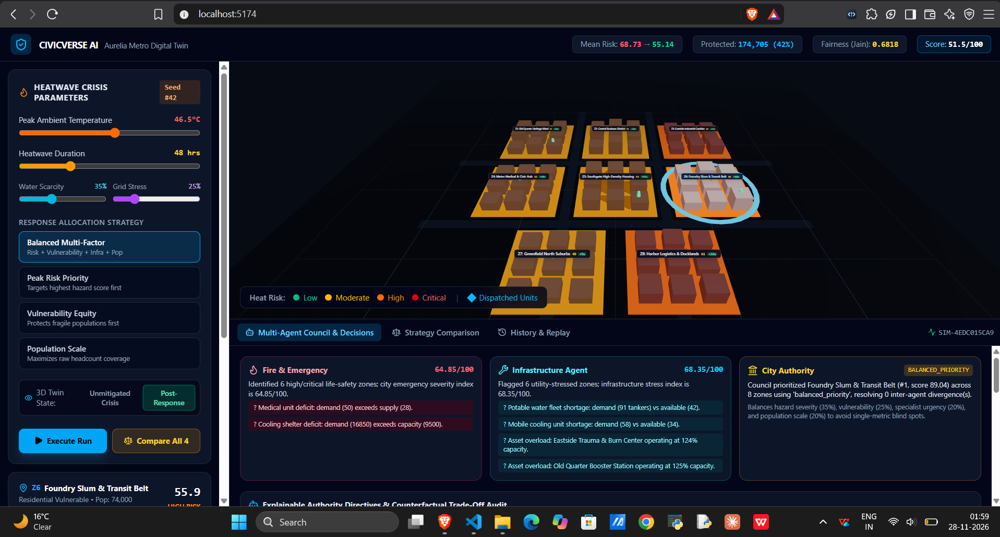
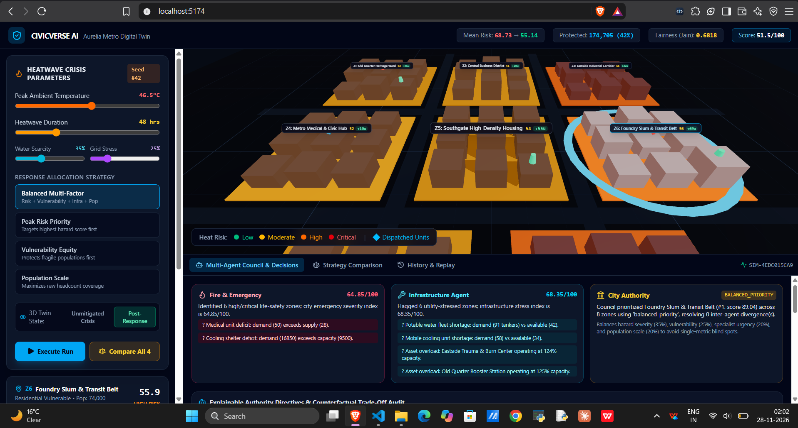
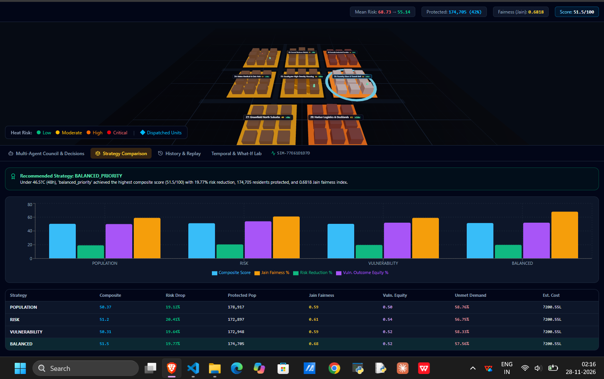
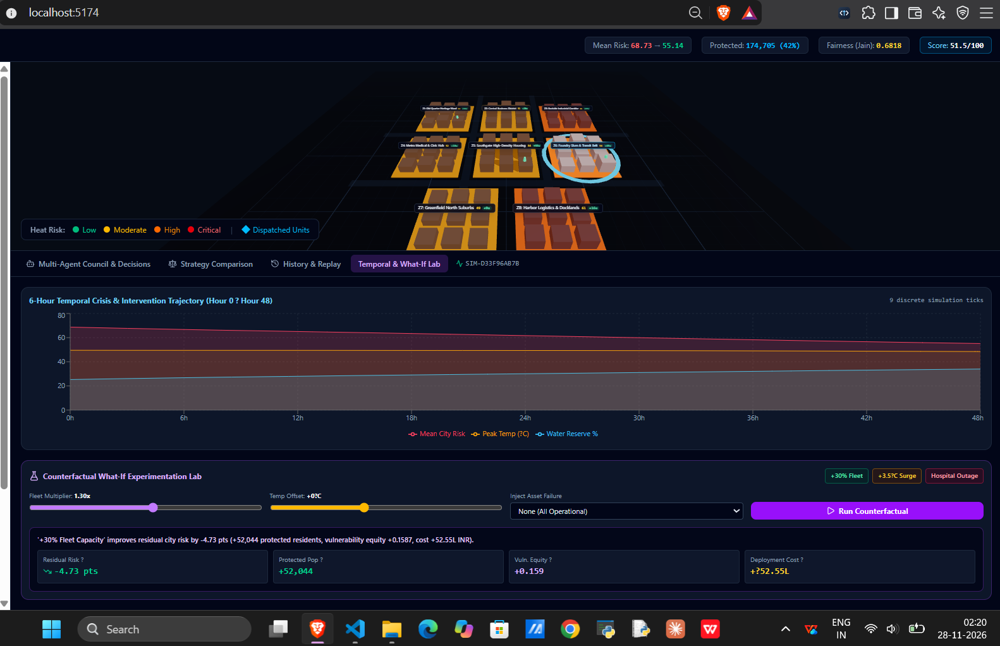
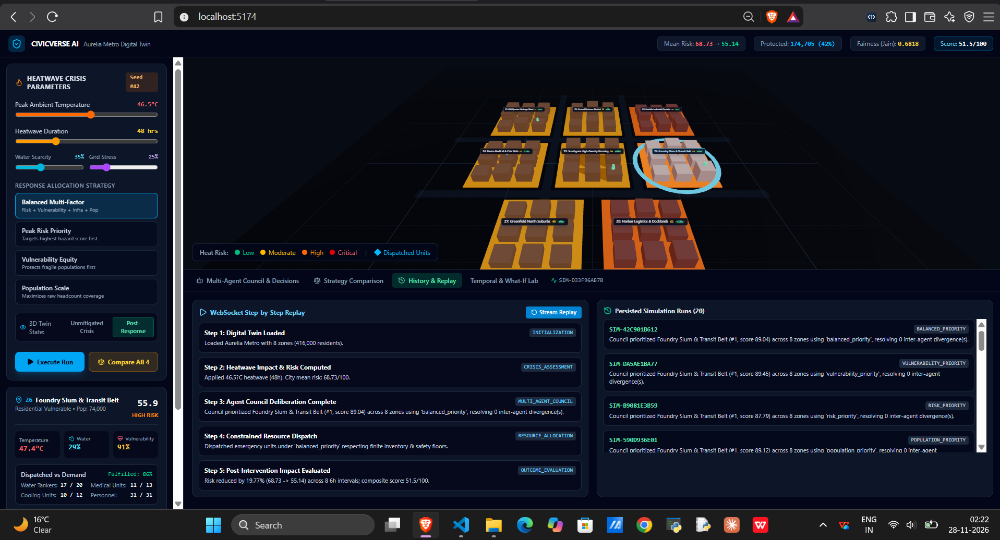
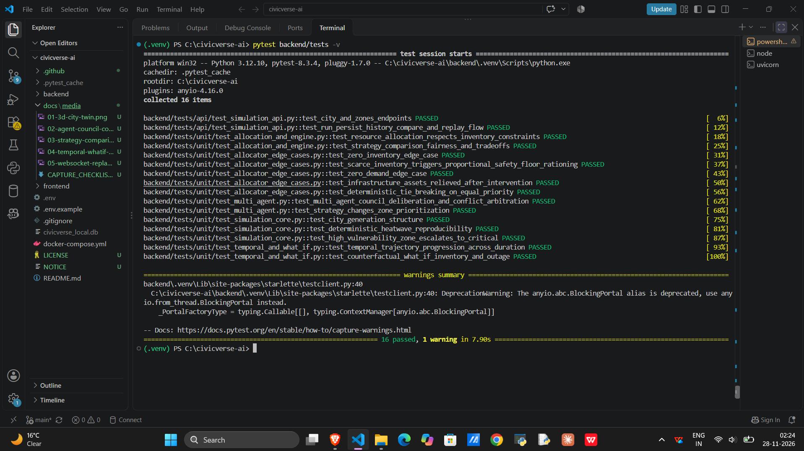

# CivicVerse AI - Urban Crisis Digital Twin & Multi-Agent Decision-Intelligence Platform

> **Author & Sole Copyright Holder:** [Tanupriya Singh](https://github.com/tanupriyasingh07) (`@tanupriyasingh07`)  
> **License:** Proprietary - All Rights Reserved (See `LICENSE` and `NOTICE` for strict anti-plagiarism and usage terms)

---

## Executive Overview

**CivicVerse AI** is an interactive, full-stack urban crisis simulation and decision-intelligence platform engineered for high-severity metropolitan heatwave response. Modeled around the **Aurelia Metro Digital Twin** (an 8-zone urban synthetic benchmark spanning high-density residential slums, medical hubs, industrial corridors, and transit networks), the platform integrates deterministic multi-hazard physics, multi-agent council arbitration, equity-constrained resource optimization, 6-hour temporal trajectory modeling, and real-time WebSocket replay streaming.

Rather than relying on black-box single-metric heuristics, CivicVerse AI arbitrates competing operational priorities across specialist civic agents (**Fire & Emergency**, **Infrastructure & Utilities**, **Public Health**, and **City Authority**) while quantifying post-intervention trade-offs via **Jain's Fairness Index**, **Vulnerability Outcome Equity**, **Residual Risk Reduction**, and **Counterfactual What-If Stress Testing**.

---

## Live System Walkthrough & Visual Evidence

### 1. Interactive 3D Urban Digital Twin (`Aurelia Metro`)
Real-time Three.js / React Three Fiber spatial twin rendering 8 urban zones (`Z1`-`Z8`), dynamic heat-risk color stratification (`Low`, `Moderate`, `High`, `Critical`), pre- vs. post-response state toggling, and dispatched emergency asset markers.



### 2. Multi-Agent Council & Conflict Arbitration
Autonomous specialist agents evaluate each zone independently, surface inter-agent priority conflicts (e.g., acute life-safety triage vs. critical power/water grid stabilization), and compute counterfactual rank shifts before **City Authority** synthesizes the final dispatch plan.



### 3. Multi-Strategy Policy Benchmarking & Equity Trade-Offs
Side-by-side evaluation across four allocation policies (`Balanced Multi-Factor`, `Peak Risk Priority`, `Vulnerability Equity`, and `Population Scale`), comparing composite effectiveness, risk reduction percentage, protected population, Jain fairness, unmet demand, and estimated deployment cost.



### 4. 6-Hour Temporal Trajectory & What-If Counterfactual Lab
Time-stepped thermal escalation and mitigation curve (`Hour 0` to `Hour 48`) paired with live counterfactual perturbation testing (`+30% Fleet`, `Hospital Outage`, `Grid Failure`, and `Extreme Surge`), reporting immediate deltas in residual risk, protected headcount, and operational cost.



### 5. Live WebSocket Timeline Replay & OpenAPI Specification
Deterministic step-by-step replay streaming over WebSockets (`/ws/simulations/{simulation_id}/replay`) backed by SQLite/SQLAlchemy run persistence and interactive Swagger/OpenAPI documentation.



### 6. Automated Verification & Regression Test Suite
End-to-end deterministic verification covering physics bounds, council arbitration invariance, fairness bounds, counterfactual deltas, SQLite persistence, and WebSocket replay streaming (`16/16` passing tests).



> **Recorded Walkthrough Video:** A complete 30-second end-to-end demonstration recording is stored at [`docs/media/civicverse-demo.mp4`](docs/media/civicverse-demo.mp4) and embedded directly in the repository showcase.

---

## System Architecture

```text
+-----------------------------------------------------------------------------------+
|                        FRONTEND: React 19 + TypeScript + Vite                     |
|  +-----------------------+  +-----------------------+  +-----------------------+  |
|  |  3D City Digital Twin |  |  Multi-Agent Council  |  | Temporal & What-If Lab|  |
|  |  (React Three Fiber)  |  |  & Conflict Inspector  |  |  (Recharts Analytics) |  |
|  +-----------+-----------+  +-----------+-----------+  +-----------+-----------+  |
|              |                          |                          |              |
|              +--------------------------+--------------------------+              |
|                                         | REST (JSON) + WebSocket (/ws/...)       |
+-----------------------------------------|-----------------------------------------+
                                          v
+-----------------------------------------------------------------------------------+
|                     BACKEND: FastAPI + Pydantic v2 + SQLAlchemy                   |
|  +-----------------------+  +-----------------------+  +-----------------------+  |
|  | Urban Heatwave Physics|  | Multi-Agent Council   |  | Resource Optimizer &  |  |
|  | & Hazard Engine       |  | & Conflict Arbiter    |  | Jain Fairness Scorer  |  |
|  +-----------+-----------+  +-----------+-----------+  +-----------+-----------+  |
|              |                          |                          |              |
|  +-----------+-----------+  +-----------+-----------+  +-----------+-----------+  |
|  | 6-Hr Temporal &       |  | SQLite / SQLAlchemy   |  | Real-Time WebSocket   |  |
|  | What-If Simulator     |  | Run & Replay Store    |  | Replay Broadcaster    |  |
|  +-----------------------+  +-----------------------+  +-----------------------+  |
+-----------------------------------------------------------------------------------+

---

## Core Engineering Modules

| Layer | Module Path | Responsibility |
| :--- | :--- | :--- |
| **Domain Schemas** | `backend/app/schemas/` | Strict Pydantic v2 contracts for city zones, heatwave parameters, council reports, strategy comparisons, and temporal trajectories. |
| **Crisis Physics** | `backend/app/services/simulation_engine.py` | Deterministic heat-index amplification, urban heat-island modeling, utility stress coupling, and post-dispatch risk attenuation. |
| **Multi-Agent Council** | `backend/app/services/agent_council.py` | Independent scoring by Fire/Emergency, Infrastructure, Public Health, and City Authority with explicit divergence detection. |
| **Optimization & Equity** | `backend/app/services/optimizer.py` | Capacity-constrained dispatch of medical units, cooling buses, water tankers, and grid crews scored via Jain's Fairness Index. |
| **Temporal & What-If** | `backend/app/services/temporal_whatif.py` | Multi-step trajectory projection and counterfactual shock evaluation (`+30% Fleet`, `Hospital Outage`, etc.). |
| **Persistence & Replay** | `backend/app/db/` & `backend/app/api/` | SQLite/SQLAlchemy simulation storage, history retrieval, and WebSocket step-by-step timeline streaming. |
| **3D Spatial Twin** | `frontend/src/components/CityTwin3D.tsx` | Interactive WebGL city visualization with dynamic zone elevation, risk color encoding, and dispatch markers. |
| **Analytics Drawers** | `frontend/src/components/` | Multi-Agent Council inspector, 4-strategy benchmark charts, Temporal What-If lab, and WebSocket replay player. |

---

## API Reference

| Method | Endpoint | Description |
| :--- | :--- | :--- |
| `GET` | `/health` | Service health check and runtime status |
| `GET` | `/api/city` | Retrieve baseline Aurelia Metro 8-zone urban digital twin topology |
| `POST` | `/api/simulations/run` | Execute a full heatwave simulation, multi-agent arbitration, and resource dispatch |
| `POST` | `/api/simulations/compare` | Benchmark all 4 allocation strategies under identical crisis conditions |
| `POST` | `/api/simulations/whatif` | Run counterfactual shock analysis against a baseline simulation |
| `GET` | `/api/simulations/history` | List persisted simulation runs from SQLite storage |
| `GET` | `/api/simulations/{simulation_id}` | Fetch full persisted payload for a specific run |
| `WS` | `/ws/simulations/{simulation_id}/replay` | Stream deterministic timeline replay events in real time |

---

## Local Setup & Execution

### Prerequisites
- **Python 3.11+**
- **Node.js 20+** and **npm**

### 1. Backend Setup (FastAPI + SQLite)
```bash
cd backend
python -m venv .venv
# Windows PowerShell:
.\.venv\Scripts\Activate.ps1
# macOS/Linux:
# source .venv/bin/activate

pip install -r requirements.txt
uvicorn app.main:app --reload --port 8001